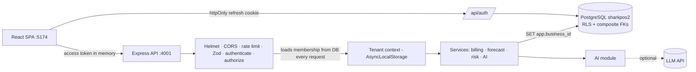

# SHARKPOS 2 — architecture (Phase 1)

## Tenancy model
- `businesses` ← `memberships` (account, business, role) → `accounts` (people who sign in; global).
- Every tenant table has `business_id NOT NULL DEFAULT current_business_id()` plus `UNIQUE (business_id, id)`.
- Child tables reference parents with composite FKs `(business_id, parent_id)` — a row can never point at another business's record, even from code that forgets a filter.
- `ROW LEVEL SECURITY` is enabled **and forced** on every tenant table: policy `business_id = current_business_id()` for reads and writes. With no tenant set the tables look empty (fail closed).
- `db.query()` runs each statement on a connection whose `app.business_id` is set from the authenticated request (AsyncLocalStorage). `sysQuery()` is for platform tables only (accounts, memberships, businesses, sessions, audit_logs).
- Uniqueness is per business (SKU, customer phone, invoice number), so two shops can use the same values.
- The runtime role `sharkpos2_app` is not a superuser, does not own tables, has no `BYPASSRLS`, and cannot update/delete `audit_logs`.
- Cached analytics are keyed `businessId:key`; `invalidateAll()` clears only the current business.

## Auth flow
1. `POST /auth/register` or `/auth/login` → access JWT (15 min, `{sub, bid, role}`) + refresh cookie (httpOnly, SameSite=Strict, path `/api/auth`).
2. Every request: verify JWT → **re-check account + membership + business status in the database** → run inside the tenant context. A token cannot be pointed at another business or claim a higher role.
3. `POST /auth/refresh` (requires `X-Requested-With`) rotates the refresh token. Presenting an already-rotated token revokes all of that account's sessions.
4. Failed logins lock the account for 15 minutes after 5 attempts.

## Roles
| Role | Scope |
|---|---|
| platform_admin | `/api/platform/*` only (no business data) |
| business_owner | everything in their business incl. employees, settings, audit log |
| manager | products, inventory, sales, refunds, customers, analytics, risk, AI; may add/edit **cashiers** only |
| cashier | POS, own sales, customer lookup/create |

## Migrations
`database/migrations/NNN_*.sql`, applied in order by `npm run migrate` as `sharkpos2_owner`, tracked in `schema_migrations`. The runner refuses non-`sharkpos2*` databases.

## Known gaps / next phases
Subscriptions, trials, payments, plan limits (Phase 2); hosting, backups, monitoring, CI/CD (Phase 3); landing page, platform dashboard metrics, support & legal pages (Phase 4). Per-business category and supplier management screens are not built yet (starter categories are created at registration).
